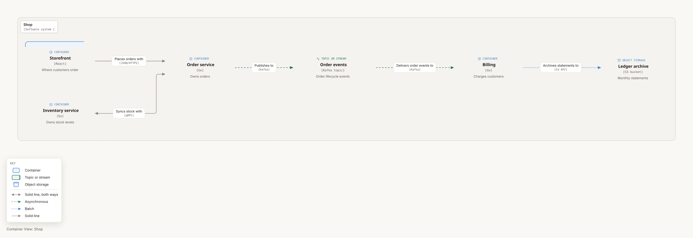
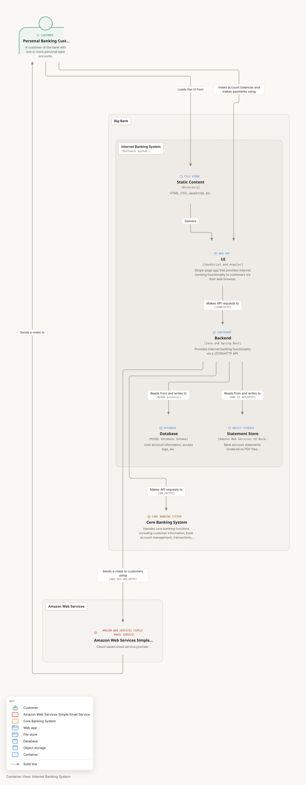
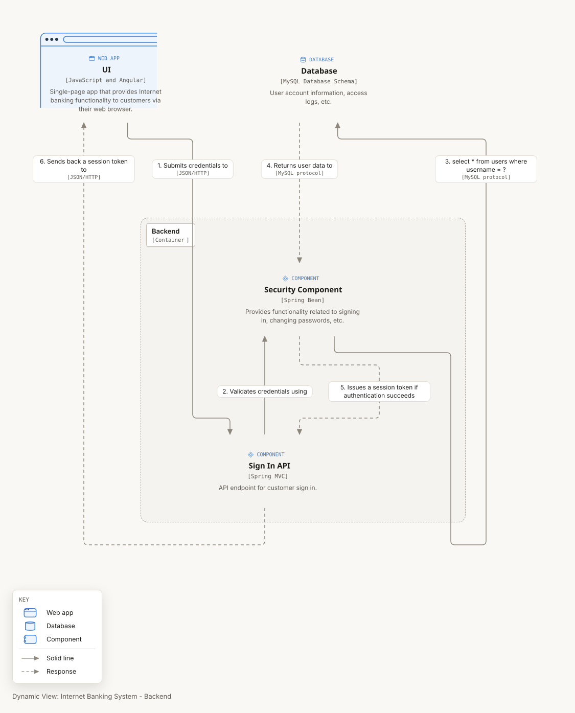

# swarm-kit-diagram

Renders [Structurizr](https://docs.structurizr.com/dsl) workspaces with the Assembly design system,
as **SVG**, **PNG**, embeddable **HTML**, and laid-out **JSON**. One command draws every view:

```sh
swarm-kit-diagram render workspace.dsl -o diagrams/
```

<picture>
  <source media="(prefers-color-scheme: dark)" srcset="examples/order-flow/images/OrderFlow.dark.svg">
  
</picture>

The official Structurizr CLI parses the DSL. ELK places every element, nests boundaries around what
they hold, and routes each relationship with orthogonal lines and its label on the line. The
Assembly design system's own diagram components draw the result. Those components are copied into
this repo (`src/vendor/assembly`), so the tool depends on no design system package.

- [Examples](#examples)
- [Install](#install)
- [Quick start](#quick-start)
- [Embedding in a page](#embedding-in-a-page)
- [CLI reference](#cli-reference)
- [Development](#development)

## Examples

Each example is a workspace in [`examples/`](examples) with every view rendered beside it. The
images below are this tool's SVG output, in light or dark to match your GitHub theme.

| Example | What it shows |
| --- | --- |
| [Big Bank](examples/big-bank) | Simon Brown's Internet Banking System: landscape, context, container, component, dynamic, and two deployment views |
| [Order flow](examples/order-flow) | Relationship styles (asynchronous, batch), a two-way relationship, shapes picked from technology |

<picture>
  <source media="(prefers-color-scheme: dark)" srcset="examples/big-bank/images/Containers.dark.svg">
  
</picture>
<picture>
  <source media="(prefers-color-scheme: dark)" srcset="examples/big-bank/images/Dynamic-Collaboration.dark.svg">
  
</picture>

## Install

Requirements:

| For | Needs |
| --- | --- |
| everything | Node 22 or newer |
| DSL input | Java 17 or newer, and the Structurizr CLI (`swarm-kit-diagram setup` fetches it) |
| PNG and SVG | Chrome or Chromium (an installed Chrome is found automatically) |

A workspace already exported as JSON needs no Java. HTML and JSON output need no browser.

### From a release

Each [release](https://github.com/swarm-kit/swarm-kit-diagram/releases) has the built package
attached. Install it globally:

```sh
npm install -g https://github.com/swarm-kit/swarm-kit-diagram/releases/download/v0.1.0/swarm-kit-diagrams-0.1.0.tgz
swarm-kit-diagram setup      # downloads the pinned Structurizr CLI into ~/.cache/swarm-kit-diagram
swarm-kit-diagram doctor     # checks Java, the Structurizr CLI, and Chrome
```

Or run it once without installing:

```sh
npx --package https://github.com/swarm-kit/swarm-kit-diagram/releases/download/v0.1.0/swarm-kit-diagrams-0.1.0.tgz swarm-kit-diagram render workspace.dsl -o diagrams
```

Or add it to a project, for example to render diagrams in its build:

```sh
npm install --save-dev https://github.com/swarm-kit/swarm-kit-diagram/releases/download/v0.1.0/swarm-kit-diagrams-0.1.0.tgz
npx --no-install swarm-kit-diagram render docs/architecture.dsl -o public/diagrams
```

`--no-install` keeps `npx` from looking the name up on the public npm registry when the project's
copy is missing. The package's only runtime dependency is `playwright-core`; everything else is
bundled into `dist/cli.js`.

Installing straight from the git repository (`npm install git+https://…`) is not supported: it
builds on install, and npm skips the build tools in a global install.

### From source

```sh
git clone https://github.com/swarm-kit/swarm-kit-diagram.git
cd swarm-kit-diagram
bun install                  # also builds dist/
node dist/cli.js setup
node dist/cli.js render examples/big-bank/workspace.dsl -o out/
npm link                     # optional: puts swarm-kit-diagram on your PATH
```

### No Chrome on the machine

```sh
swarm-kit-diagram setup --browser                          # installs a headless Chromium
SWARM_KIT_DIAGRAM_CHROME=/path/to/chrome swarm-kit-diagram render ...   # or point at one
```

### In CI

```yaml
# GitHub Actions: render every view, fail on layout problems, keep the result
- uses: actions/setup-node@v4
  with: { node-version: 22 }
- uses: actions/setup-java@v4
  with: { distribution: temurin, java-version: 21 }
- run: npm install -g https://github.com/swarm-kit/swarm-kit-diagram/releases/download/v0.1.0/swarm-kit-diagrams-0.1.0.tgz
- run: swarm-kit-diagram setup
- run: swarm-kit-diagram render docs/workspace.dsl -o diagrams --check
- uses: actions/upload-artifact@v4
  with: { name: diagrams, path: diagrams }
```

GitHub's Ubuntu runners have Chrome installed. `--check` fails the job when a view has a label on an
element, a line through an element, or lines that cross.

## Quick start

```sh
swarm-kit-diagram views workspace.dsl                        # what views are there?
swarm-kit-diagram render workspace.dsl -o out                # everything, every view
swarm-kit-diagram render workspace.dsl -v Containers -f svg  # one view, one format
swarm-kit-diagram render workspace.dsl -f png --scale 3 --theme dark
swarm-kit-diagram render workspace.json -f html,json         # from an export: no Java, no Chrome
cat workspace.dsl | swarm-kit-diagram render - -f svg        # DSL on stdin
swarm-kit-diagram check workspace.dsl                        # exit 1 on layout problems
```

For each view key `K`, the output folder gets:

| File | What it is |
| --- | --- |
| `K.svg` | plain SVG: shapes, paths, and text, no CSS or scripts |
| `K.png` | the same picture at `--scale` density |
| `K.html` | a page for an `<iframe>`: interactive canvas, with the static picture as its no-script fallback |
| `K.fragment.html` | static HTML to paste into a page, no script |
| `K.json` | the laid-out diagram, which the web component reads |
| `assembly-diagram.js` | the web component, shared by every view |
| `index.html` | a preview of every output beside the snippet that embeds it |

Open `index.html` to see each output and copy its embed code.

## Embedding in a page

Choose by how interactive the diagram should be and what the host page allows:

| | Interactive | Isolation from the host's CSS | The host needs |
| --- | --- | --- | --- |
| [Image](#image) | no | complete | nothing |
| [iframe](#iframe) | yes | complete | to allow framing the file |
| [Web component](#web-component) | yes | complete inside; the element's own box is the host's | to allow the script, `font-src data:`, and `connect-src` for `src` |
| [HTML fragment](#html-fragment) | no | strong, not total | inline styles |

### Image

```html

```

Each character sits where the browser placed it, and colours are `rgb()`. That makes the SVG look
the same in an ``, inlined in HTML, in Figma, or in Inkscape. Ids are unique per diagram, so
several SVGs can be inlined in one page. With `--fonts system` a file shrinks from about 220 KB to
about 50 KB and uses installed Inter and JetBrains Mono, or system fonts without them.

### iframe

```html
<iframe src="diagrams/Containers.html" title="Container view" loading="lazy"
  sandbox="allow-scripts" referrerpolicy="no-referrer"
  style="width:100%;aspect-ratio:1193/3053;max-height:80vh;border:0"></iframe>
```

The page is one self-contained file that makes no network requests. It runs under
`sandbox="allow-scripts"` (no `allow-same-origin`), and with scripts off it shows the static
picture. It reports its height to the parent page as
`{ type: "assembly-diagram:resize", key, height }`. `index.html` has a listener that sizes the
frame and checks `event.source`. Use `src`, not `srcdoc`: a `srcdoc` frame inherits the host's
Content-Security-Policy.

### Web component

```html
<script src="assembly-diagram.js" defer></script>

<assembly-diagram src="diagrams/Containers.json" theme="auto">
    <!-- shown until the script runs -->
</assembly-diagram>
```

Or with the data inline, which saves a request:

```html
<assembly-diagram theme="dark" mode="static">
  <script type="application/json">{ "format": "assembly-diagram", "version": 1, ... }</script>
</assembly-diagram>
```

| Attribute | Values |
| --- | --- |
| `src` | URL of the view's `.json` (same origin, or CORS-enabled) |
| `theme` | `light`, `dark`, `auto` (default: follows the reader's colour scheme) |
| `mode` | `interactive` (pan, zoom, select; default) or `static` (a picture scaled to fit) |
| `height` | px or any CSS length; by default the diagram's own aspect ratio |
| `toolbar`, `minimap`, `legend`, `caption` | `"false"` hides that part |

Events: `assembly-diagram:ready` and `assembly-diagram:error`. One script serves every diagram on
a page: 615 KB, 266 KB gzipped, of which about 140 KB is embedded fonts. The script can load
anywhere, including synchronously in `<head>`. The diagram draws in a shadow root, so the host's
CSS cannot restyle it. Its styles and fonts are added as constructed stylesheets, which a strict
`style-src` allows.

### HTML fragment

Paste `K.fragment.html` into any page. Every rule sits under a doubled scope class, the HTML it
renders is reset first, and its keyframes and font families are renamed. Host rules such as
`* { margin }`, `div { border }`, `p { color }`, or `svg { height: auto }` leave it unchanged
(tested pixel for pixel). Three things still get through: `!important` rules, ID selectors, and
paint on bare SVG selectors (`path { stroke: red }`). For those hosts, use the iframe or the web
component. With several fragments on one page, `--fragment-css external` writes their styles once.

All workspace text is escaped in every output, including JSON inside `<script>` elements.

## CLI reference

```
swarm-kit-diagram render <workspace> [options]   images, HTML, and JSON for each view
swarm-kit-diagram views <workspace>              the views a workspace defines
swarm-kit-diagram check <workspace> [-v key]     layout problems; exits 1 if there are any
swarm-kit-diagram runtime [-o dir]               just the web component script
swarm-kit-diagram setup [--browser]              fetch the Structurizr CLI (and Chromium)
swarm-kit-diagram doctor                         what is installed, and what is missing
swarm-kit-diagram --help | --version
```

`<workspace>` is a `.dsl` file (its `!include`s resolve from its folder), an exported `.json`, or `-`
for DSL on stdin.

| Option | Default | |
| --- | --- | --- |
| `-o, --out <dir>` | `diagrams` | |
| `-f, --format <list>` | `png,svg,html,json` | |
| `--html <list>` | `page,component,fragment` | which HTML outputs |
| `-v, --view <key>` | every view | repeatable |
| `--theme <t>` | `auto` | `light`, `dark`, or `auto` (images draw `auto` as light) |
| `--scale <n>` | `2` | PNG pixel density |
| `--fonts <f>` | `embed` | `embed`, `system`, or a URL serving the woff2 files |
| `--legend <where>` | `bottom` | `bottom`, `right`, `none` |
| `--no-caption`, `--transparent` | | |
| `--page-mode <m>` | `interactive` | the iframe page: `interactive` or `static` |
| `--runtime <r>` | `inline` | the iframe page's script: `inline` or `external` |
| `--fragment-css <c>` | `inline` | `inline`, or `external` (one shared `assembly-diagram.css`) |
| `--check` | | fail before writing anything if a view has a layout problem |
| `--layout-options <json>` | | ELK option overrides, for tuning a layout |
| `--no-index` | | skip `index.html` |

Exit codes: `0` success, `1` the work failed (a parse error, an unknown view, a layout problem
under `--check`), `2` a usage mistake.

| Environment | |
| --- | --- |
| `STRUCTURIZR_CLI` | a `structurizr.sh` to use instead of the cached, pinned release |
| `SWARM_KIT_DIAGRAM_CHROME` | a Chrome or Chromium for PNG and SVG |
| `SWARM_KIT_DIAGRAM_CACHE` | where `setup` downloads to (default `~/.cache/swarm-kit-diagram`) |

## Development

```sh
bun install                  # dependencies, then builds dist/
bun run test                 # builds, then runs vitest
bun run typecheck
bun run dev render examples/order-flow/workspace.dsl -o out   # from source
bun run examples             # re-renders the images in examples/
```

The image tests need Chrome. The DSL tests need Java and the Structurizr CLI. Each skips itself when
its tool is missing.

| Path | |
| --- | --- |
| `src/core` | parse the workspace, plan each view, size, lay out (ELK), check |
| `src/render` | static markup, scoped styles, PNG and SVG capture, HTML outputs, the preview |
| `src/embed` | the browser runtime (web component) and the JSON document |
| `src/ds.ts` | the one module that knows where the vendored design system lives |
| `src/vendor/assembly` | the copied design system; regenerate, never edit |

### Updating the design system

```sh
bun run vendor                          # from ../swarmkit-assembly/packages/ui
bun run vendor -- --from <ds package>   # or any copy of @swarm-kit/assembly
```

This copies every file the diagram components import, type imports included. It cuts
`components.css` down to the rules for the `sk-*` classes those files render, and copies the tokens
and fonts. Review the diff, then run `bun run test` and `bun run examples`. `src/core/label.ts`
estimates label sizes from the design system's typography, so a typography change needs its
constants checked.

### Releasing

```sh
# bump "version" in package.json and VERSION in src/cli.ts, then:
bun run test
npm pack                                   # swarm-kit-diagrams-<version>.tgz, built by prepare
gh release create v<version> swarm-kit-diagrams-<version>.tgz --generate-notes
```

## License

[MIT](LICENSE), covering this tool and the copy of the Assembly design system in `src/vendor`.

- The fonts (Inter, JetBrains Mono, Space Grotesk) are under the SIL Open Font License 1.1:
  [`src/vendor/assembly/assets/fonts/OFL.txt`](src/vendor/assembly/assets/fonts/OFL.txt).
  Embedded SVG and HTML output carries them, which the license allows.
- `dist/cli.js` and `assembly-diagram.js` bundle [React](https://github.com/facebook/react) (MIT),
  [clsx](https://github.com/lukeed/clsx) (MIT), [tailwind-merge](https://github.com/dcastil/tailwind-merge)
  (MIT), and, in the CLI only, [PostCSS](https://github.com/postcss/postcss) (MIT) and
  [elkjs](https://github.com/kieler/elkjs) (EPL-2.0; its source is at that link).
- The [Structurizr CLI](https://github.com/structurizr/cli) (Apache-2.0) is downloaded by `setup`,
  not bundled.
- The Big Bank example is Simon Brown's Internet Banking System from
  [structurizr/examples](https://github.com/structurizr/examples).
