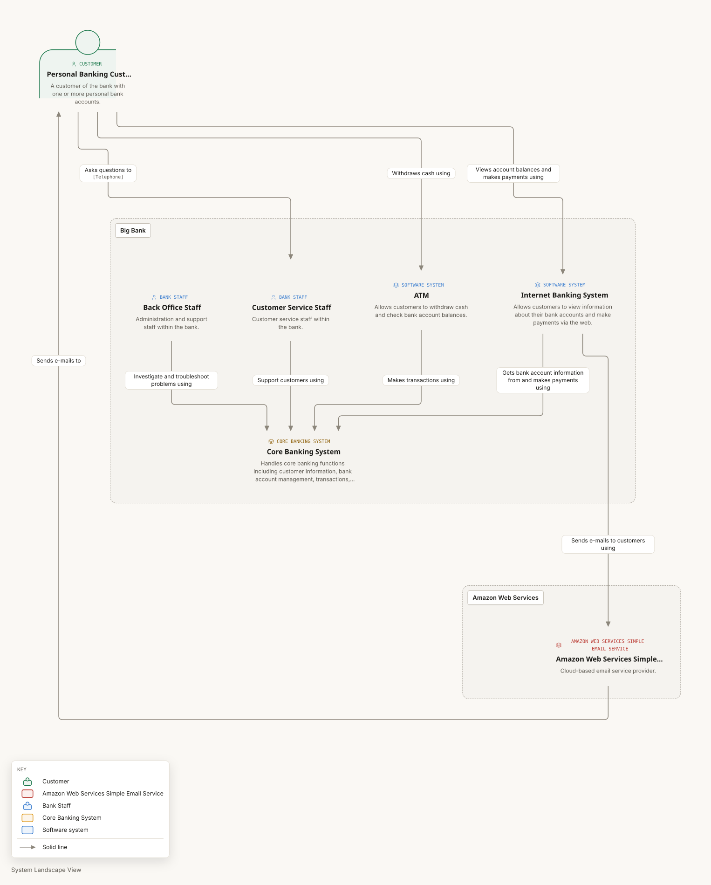
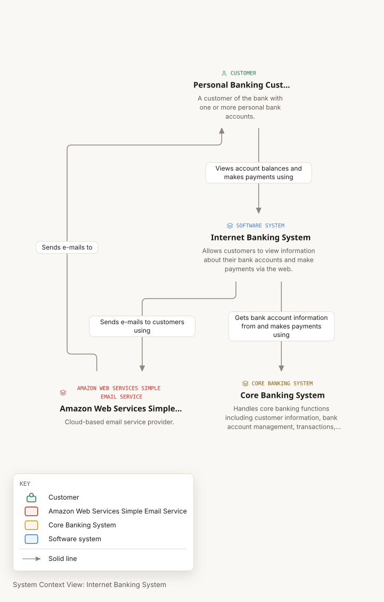
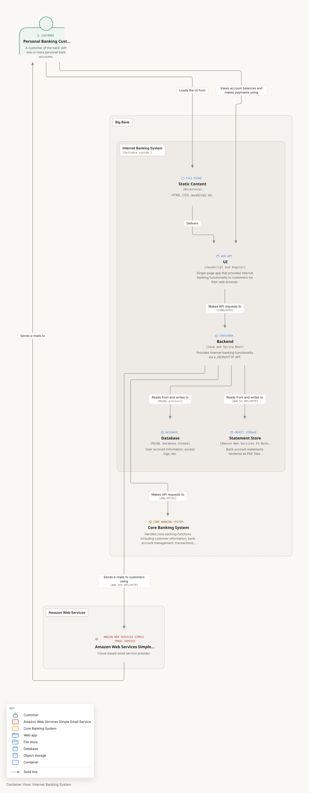
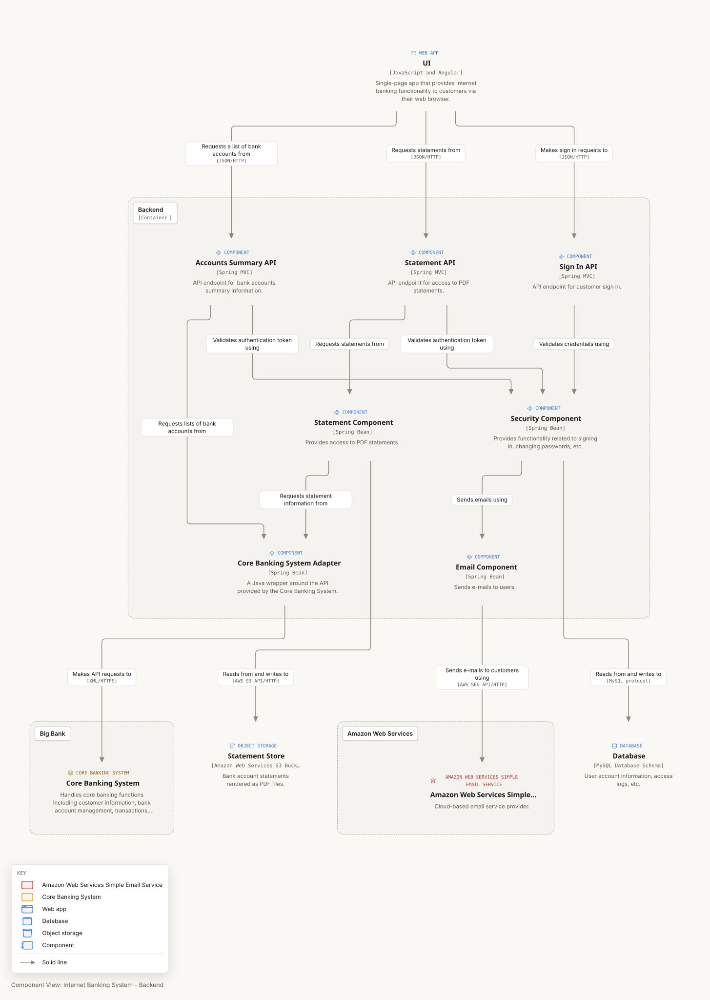
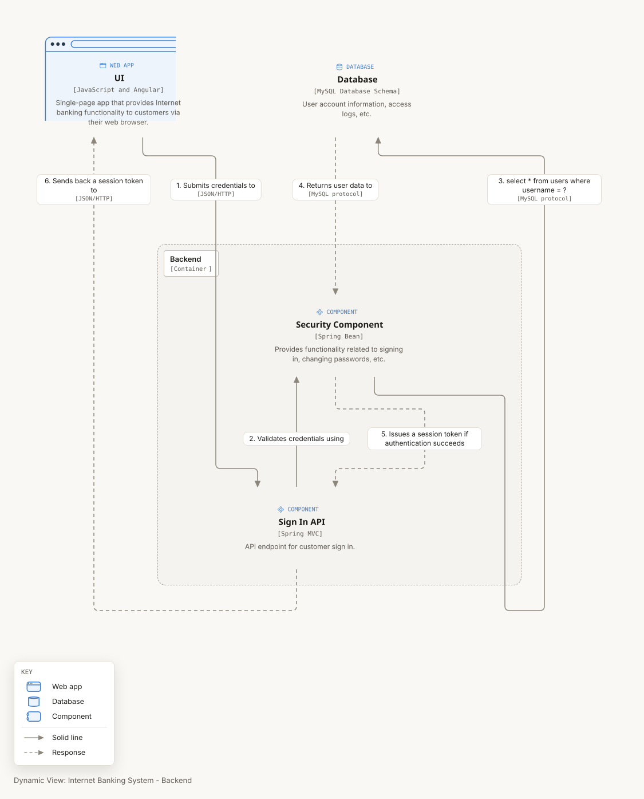
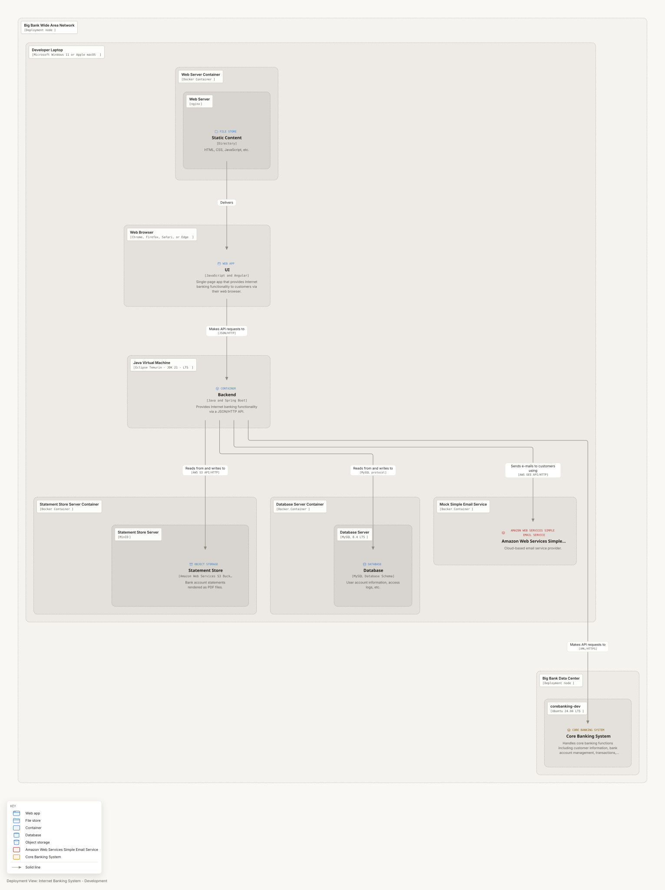
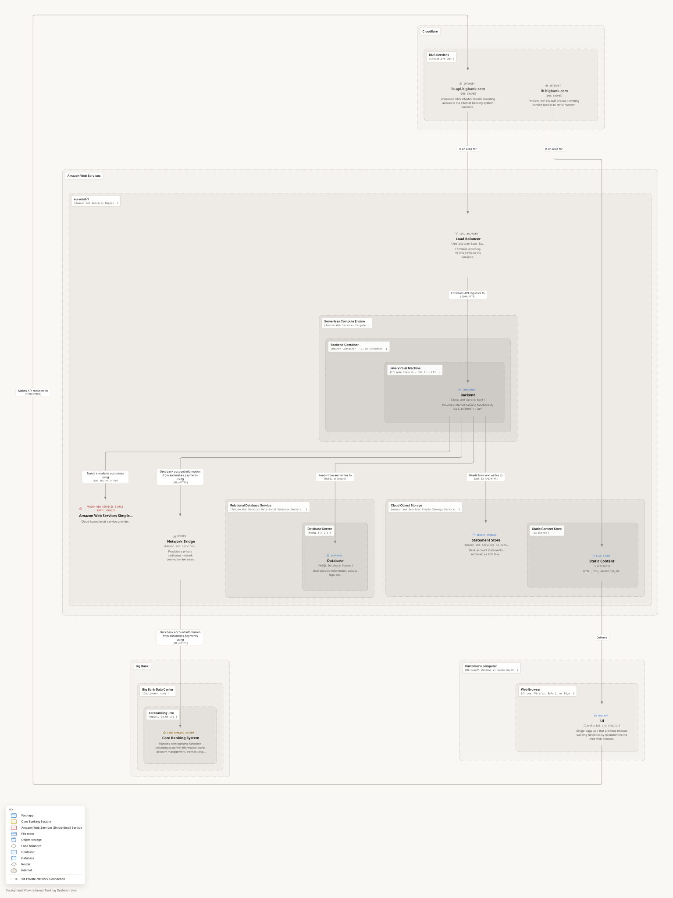

# Big Bank

Simon Brown's Internet Banking System, the standard Structurizr example ([source](https://github.com/structurizr/examples)). One workspace, seven views: a system landscape, a system context, a container view, a component view, a dynamic view of signing in, and development and live deployments.

The component view keeps one line crossing that no ELK option removes; `swarm-kit-diagram check` reports it.

Rendered from [`workspace.dsl`](workspace.dsl) with:

```sh
swarm-kit-diagram render examples/big-bank/workspace.dsl -o out/big-bank
```

The images here are its SVG output, light or dark to match your GitHub theme. `bun run examples` regenerates them.

## System Landscape View

<picture>
  <source media="(prefers-color-scheme: dark)" srcset="images/SystemLandscape.dark.svg">
  
</picture>

## System Context View: Internet Banking System

<picture>
  <source media="(prefers-color-scheme: dark)" srcset="images/SystemContext.dark.svg">
  
</picture>

## Container View: Internet Banking System

<picture>
  <source media="(prefers-color-scheme: dark)" srcset="images/Containers.dark.svg">
  
</picture>

## Component View: Internet Banking System - Backend

<picture>
  <source media="(prefers-color-scheme: dark)" srcset="images/Components.dark.svg">
  
</picture>

## Dynamic View: Internet Banking System - Backend

<picture>
  <source media="(prefers-color-scheme: dark)" srcset="images/Dynamic-Collaboration.dark.svg">
  
</picture>

## Deployment View: Internet Banking System - Development

<picture>
  <source media="(prefers-color-scheme: dark)" srcset="images/Deployment-Development.dark.svg">
  
</picture>

## Deployment View: Internet Banking System - Live

<picture>
  <source media="(prefers-color-scheme: dark)" srcset="images/Deployment-Live.dark.svg">
  
</picture>
