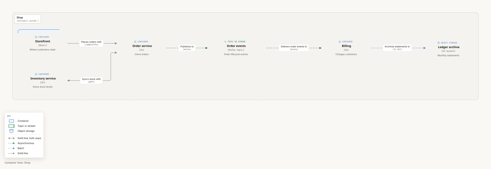

# Order flow

A small shop as a container view. It shows what the workspace's styles turn into: the `Asynchronous` and `Batch` relationship tags become a dashed green and a dotted blue line, named in the key; the two relationships declared both ways with the same description ("Syncs stock with") become one line with an arrowhead at each end; and the Kafka topic and the S3 bucket are drawn as a stream and as object storage, picked from their technology.

Rendered from [`workspace.dsl`](workspace.dsl) with:

```sh
swarm-kit-diagram render examples/order-flow/workspace.dsl -o out/order-flow
```

The images here are its SVG output, light or dark to match your GitHub theme. `bun run examples` regenerates them.

## Container View: Shop

<picture>
  <source media="(prefers-color-scheme: dark)" srcset="images/OrderFlow.dark.svg">
  
</picture>
